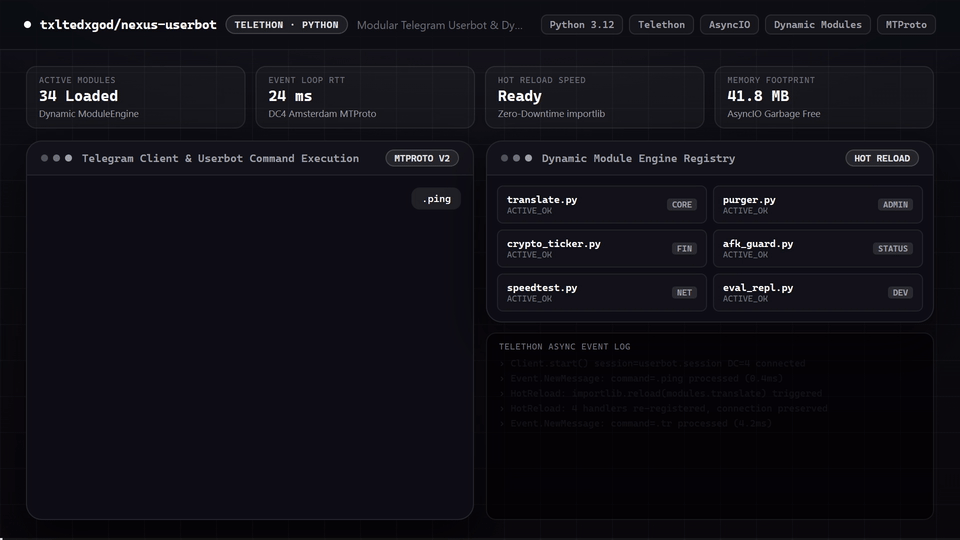

# ✦ NEXUS USERBOT ✦
> **Next-Generation High-Performance Modular Telegram Userbot with Luxury Premium Emoji UI & Dynamic Hot-Reloading**

[](LICENSE)
[](https://python.org)
[](https://github.com/LonamiWebs/Telethon)
[-brightgreen.svg)](#)
[](#)

---

## 🎬 Feature Demo

<p align="center">
  
</p>
<p align="center">
  <sub><a href="assets/demo.mp4">Watch / Download 1080p60 MP4</a></sub>
</p>

---
---

## ⚡ Key Highlights

- **Dynamic Module Engine**: Hot-load, unload, and reload modules at runtime without dropping connections (`.load`, `.unload`, `.reload`).
- **Luxury Premium UI**: Custom Telegram Premium emoji rendering, Cyberpunk & Neon themes, structured cards, and status badges.
- **12 Production Subsystems**: Out-of-the-box suites for moderation, AI assistance, lead generation, crypto rates, media processing, and stealth privacy.
- **Persistent SQLite KV Store**: Atomic, namespaced key-value storage for per-module configuration and persistent states.
- **Asynchronous & Non-blocking**: Fully built on `asyncio` and `telethon` for sub-millisecond command handling.
- **Zero Memory Leaks**: Clean watcher lifecycle, resource disposal, and graceful degradation.

---

## 🏛 Architecture

```
nexus-userbot/
├── main.py                  # Application entrypoint & signal orchestrator
├── nexus/
│   ├── client.py            # TelegramClient wrapper & event dispatcher
│   ├── config.py            # Typed settings & environment loader
│   ├── database.py          # SQLite KV storage engine
│   ├── loader.py            # Dynamic module & watcher decorator system
│   ├── logger.py            # ANSI colored terminal logger
│   ├── ui.py                # Luxury Premium UI card formatter
│   ├── utils.py             # Helpers (shlex parser, duration, byte formatters)
│   └── modules/             # 12 Built-in & dynamic modules
│       ├── core.py          # .help, .ping, .modules, .reload, .theme
│       ├── admin.py         # .purge, .del, .pin, .unpin, .user, .id
│       ├── ai_assistant.py  # .ai, .summary, .pitch_ai
│       ├── crypto.py        # .p, .qr, .gas
│       ├── downloader.py    # .dl, .dem
│       ├── leads.py         # .scanleads, .addkeyword, .keywords
│       ├── media.py         # .circle, .voice, .mediainfo
│       ├── profile.py       # .afk, .unafk, .setbio, .setname, .clone
│       ├── reactions.py     # .autoreact, .delreact, .reacts, .flex
│       ├── stealth.py       # .dmmute, .undmmute, .antidel
│       ├── terminal.py      # .eval, .exec, .sh, .sys
│       ├── text.py          # .type, .paste, .hide, .translit
│       └── theme.py         # .settheme, .setemoji, .emojipack
└── tests/                   # 34 Automated unit test suites
```

---

## 📦 Built-in Modules & Command Matrix

| Module | Commands | Description |
| :--- | :--- | :--- |
| **Admin** (`admin.py`) | `purge`, `del`, `pin`, `unpin`, `user`, `id` | High-speed message purge, pin/unpin, user inspection, and moderation suite. |
| **AIAssistant** (`ai_assistant.py`) | `ai`, `summary`, `pitch_ai` | Neural AI prompt assistant, chat thread summarizer, and automated pitch generator. |
| **Core** (`core.py`) | `ping`, `help`, `modules`, `prefix`, `theme`, `reload` | Core management system, module loader, and latency diagnostics. |
| **Crypto** (`crypto.py`) | `p`, `qr`, `gas` | Live cryptocurrency prices, QR code payment generator, and blockchain gas tracker. |
| **Downloader** (`downloader.py`) | `dem`, `dl` | Universal media downloader (TikTok/Reels/Shorts) and instant demotivator meme generator. |
| **Leads** (`leads.py`) | `scanleads`, `addkeyword`, `delkeyword`, `keywords`, `setalert` | Automated freelance order detector, keyword filter, and lead alert dispatcher. |
| **Media** (`media.py`) | `circle`, `voice`, `mediainfo` | Video to circular note converter, voice synthesizer, and metadata inspector. |
| **Profile** (`profile.py`) | `afk`, `unafk`, `setbio`, `setname`, `clone`, `revert` | Stealth profile cloner, identity reverter, and AFK auto-responder. |
| **Reactions** (`reactions.py`) | `autoreact`, `delreact`, `reacts`, `flex` | Automated user reaction watcher, emoji sniper, and visual flex animations. |
| **Stealth** (`stealth.py`) | `dmmute`, `undmmute`, `dmmuted`, `antidel` | DM blackhole mute (auto-delete incoming messages), ghost mode, and anti-delete logger. |
| **Terminal** (`terminal.py`) | `eval`, `exec`, `sh`, `sys` | Developer power tools: async eval/exec, shell terminal, and hardware diagnostics. |
| **Text** (`text.py`) | `type`, `paste`, `hide`, `translit`, `quote` | Animated typewriter, text formatting, transliteration, and pastebin uploader. |
| **Theme** (`theme.py`) | `settheme`, `setemoji`, `emojipack`, `carddemo` | Luxury theme manager, custom emoji palette configurer, and visual showcase. |

> 📖 **Full Command Reference**: See [MODULES.md](MODULES.md) for detailed descriptions, arguments, and usage guides for all 40+ commands.

---

## 🚀 Quick Start

### 1. Clone & Install
```bash
git clone https://github.com/txltedxgod/nexus-userbot.git
cd nexus-userbot
pip install -r requirements.txt
```

### 2. Configure Credentials
Copy `.env.example` to `.env` and fill in your API credentials from [my.telegram.org](https://my.telegram.org):
```ini
API_ID=12345678
API_HASH=abcdef1234567890abcdef1234567890
SESSION_NAME=nexus_userbot
DEFAULT_PREFIX=.
DEFAULT_THEME=neon_cyber
```

### 3. Launch
```bash
python main.py
```

---

## 🧪 Testing & Verification

The entire codebase is verified with automated unit tests across Python 3.10, 3.11, and 3.12:

```bash
python -m unittest discover -s tests -p "*.py"
```

All 34 test cases run in isolation using mock Telegram clients and in-memory SQLite storage:
```text
Ran 34 tests in 0.212s
OK
```

---

## 🛠 Writing Custom Modules

Creating a module is as simple as defining a class with the `@module` and `@command` decorators:

```python
from telethon.tl.custom import Message
from nexus.loader import BaseModule, module, command

@module(name="Echo", description="Simple echo module", author="txltedxgod", version="1.0.0")
class EchoModule(BaseModule):
    @command(name="echo", description="Echo text back", usage=".echo <text>")
    async def cmd_echo(self, message: Message, args: list):
        text = " ".join(args) or "Echo!"
        await message.edit(self.ui.card(title="ECHO", fields={"Text": text}, icon="zap"))
```

---

## 📜 License
Released under the [MIT License](LICENSE). Built with 🖤 by [@txltedxgod](https://github.com/txltedxgod).
